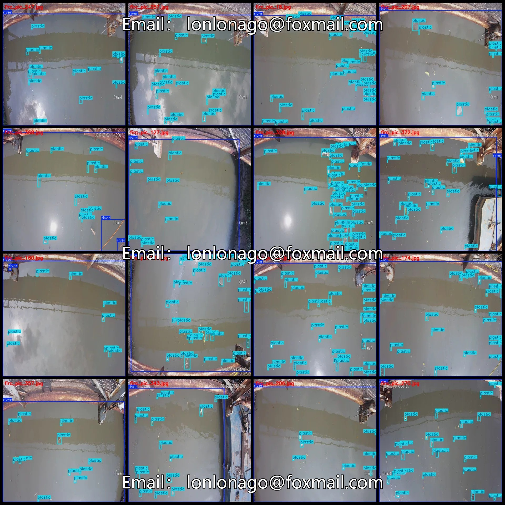
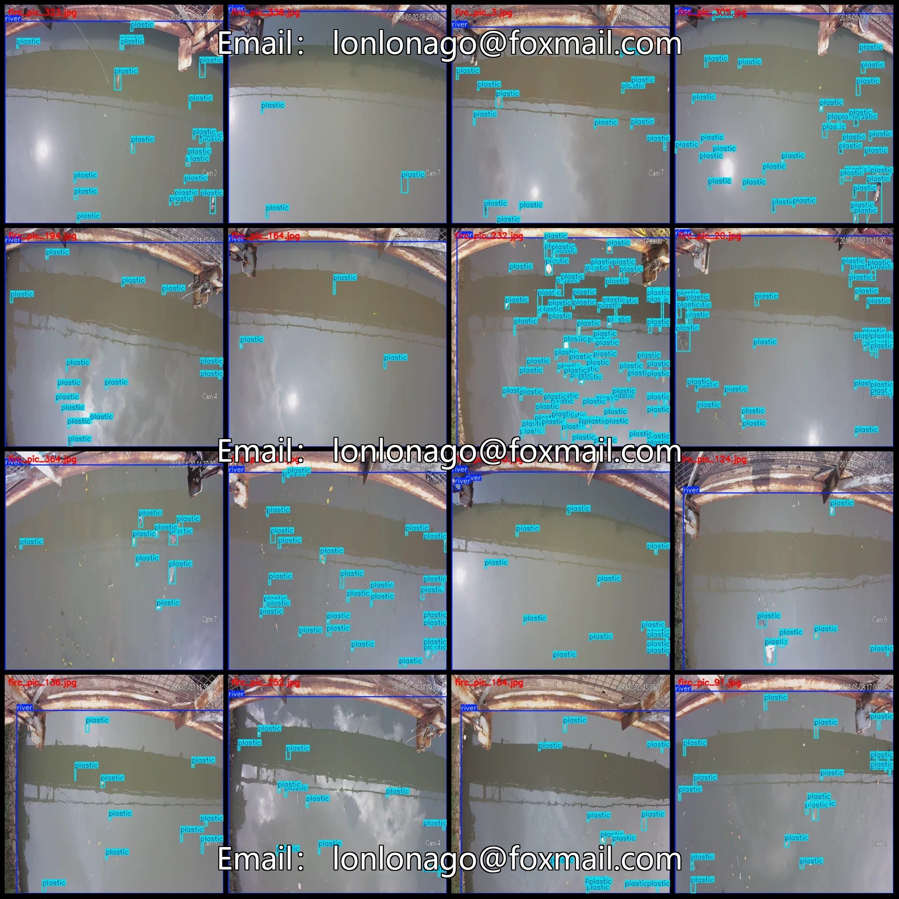
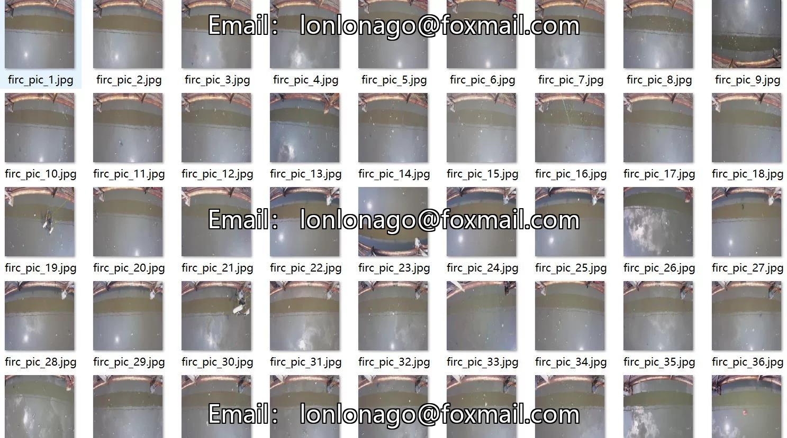
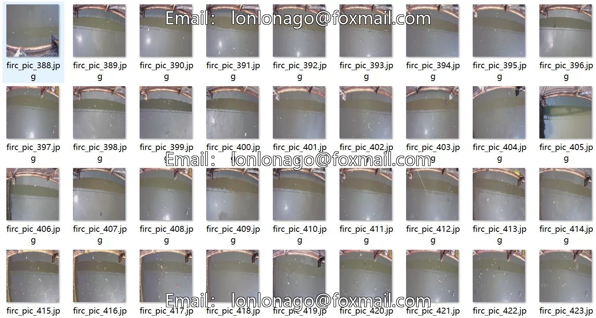
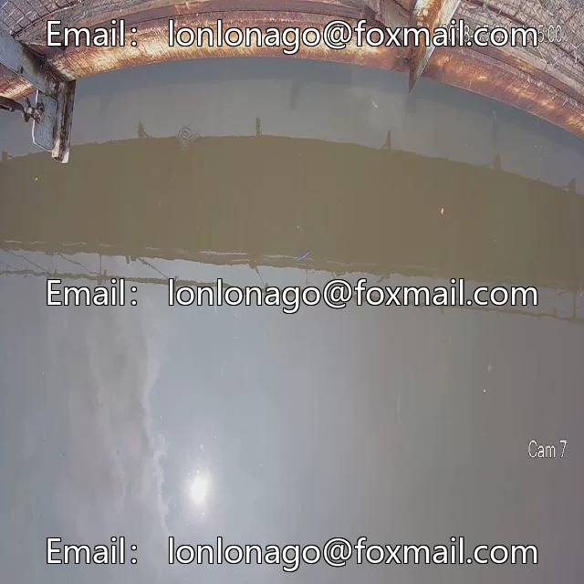
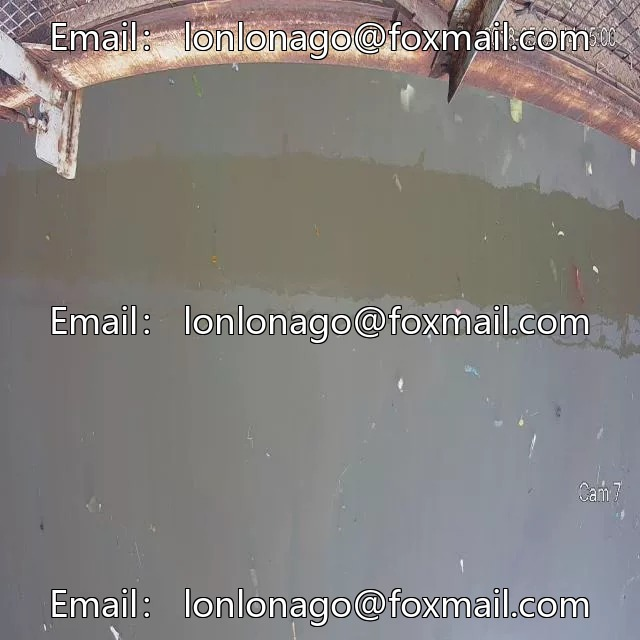
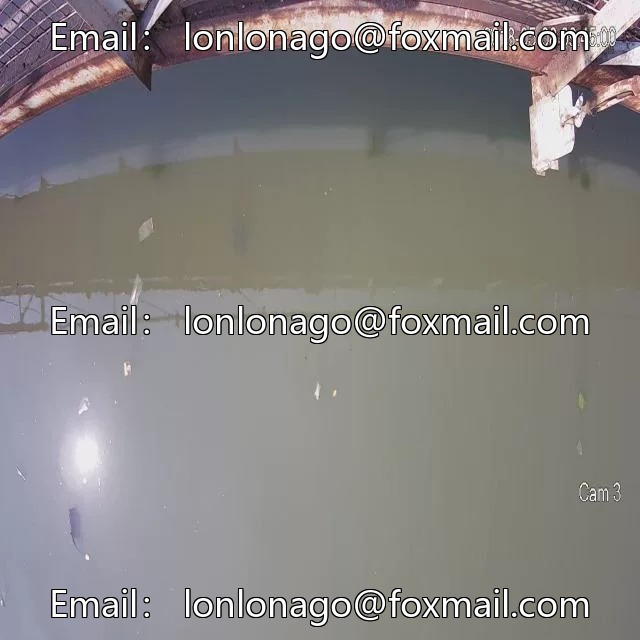

# Drone-view river channel plastic waste detection dataset VOC+YOLO format, 492 images

## Body

Drone-View River Plastic Waste Detection Dataset in VOC+YOLO format: 492 images, 2 categories
Warm Reminder: Due to the dataset's replicability, please confirm compliance before purchasing.
Dataset format: Pascal VOC format + YOLO format (txt file without split path, only containing jpg images and corresponding VOC format xml files and yolo format txt files)
Number of images (number of jpg files): 492
Number of annotations (number of xml files): 492
Number of annotations (number of txt files): 492
Number of annotation categories: 2

Label categories (note that the order of labels in YOLO format does not correspond to this, but is based on the 'labels' folder with 'classes.txt'): ['plastic', 'river']
Number of bounding boxes and images per category
For 'plastic': 11060 bounding boxes, 492 images
For 'river': 565 bounding boxes, 480 images
Total number of bounding boxes: 11625
Image resolution: 640x640
Annotation tool used: labelImg
Annotation rules: Draw a rectangle around the category
Important note: The dataset does not have splits for training, validation, or testing; you will need to manually divide it.
Special declaration: This dataset does not guarantee the accuracy of the trained models or weight files.

## Images

## Payment

Here is a pay link on Stripe ( https://buy.stripe.com/3cs8yP7sY87d0vu9AB ). Please contact me lonlonago@foxmail.com after funding $89, and I will send you a complete data files , thank you!

